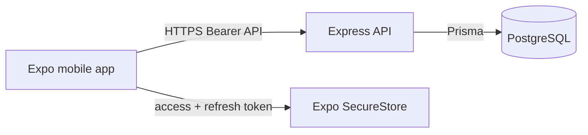

# Expo Auth Starter

Full-stack Expo authentication starter: Expo Router, Zustand, React Hook Form, Express, PostgreSQL, Prisma, bcrypt, JWT access tokens, and rotating refresh tokens.

> Local development starter. Add HTTPS, managed secrets, email verification, password reset, monitoring, and production database backups before production deployment.

## Architecture



- Passwords: bcrypt hashes only.
- Access token: short lived, memory only.
- Refresh token: stored in Expo SecureStore; server stores SHA-256 hash and rotates it on every refresh.
- Protected routes: Expo Router `Stack.Protected`.

## Prerequisites

- Node.js 22+
- Docker Desktop
- Android Studio emulator, iOS simulator, or Expo Go device

## Start

### 1. Clone and configure

```bash
git clone https://github.com/YOUR_GITHUB_USER/expo-auth-starter.git
cd expo-auth-starter
cp .env.example .env
cp server/.env.example server/.env
cp mobile/.env.example mobile/.env
```

PowerShell:

```powershell
Copy-Item .env.example .env
Copy-Item server/.env.example server/.env
Copy-Item mobile/.env.example mobile/.env
```

Replace `JWT_ACCESS_SECRET` and `JWT_REFRESH_SECRET` in `server/.env` with distinct random strings of 32+ characters.

### 2. Install dependencies and database

```bash
npm install
npm install --prefix server
npm install --prefix mobile
docker compose up -d postgres
npm run db:migrate
```

### 3. Start API and mobile app

Terminal 1:

```bash
npm run dev:server
```

Terminal 2:

```bash
npm run dev:mobile
```

Open Android emulator, iOS simulator, web, or Expo Go from Expo CLI.

## Mobile API URL

Set `EXPO_PUBLIC_API_URL` in `mobile/.env`:

| Target | Value |
| --- | --- |
| Android emulator | `http://10.0.2.2:3000` |
| iOS simulator / web | `http://localhost:3000` |
| Physical device | `http://YOUR_COMPUTER_LAN_IP:3000` |

Physical device needs same LAN as computer. Do not use `localhost` from device. Configure `CORS_ORIGIN` in `server/.env` for web clients. Use HTTPS before deploying beyond trusted local networks.

## API

| Method | Endpoint | Purpose |
| --- | --- | --- |
| `POST` | `/auth/register` | Create account and token pair |
| `POST` | `/auth/login` | Login and token pair |
| `POST` | `/auth/refresh` | Rotate refresh token |
| `POST` | `/auth/logout` | Revoke refresh token |
| `GET` | `/auth/me` | Get authenticated user |

`POST /auth/register` and `POST /auth/login` body:

```json
{ "email": "person@example.com", "password": "at-least-12-characters" }
```

## Quality checks

```bash
npm run lint --workspace=server
npm test --workspace=server
npm run lint --workspace=mobile
npm test --workspace=mobile
```

## Security limits

- Never commit `.env`, `node_modules`, Expo state, database volume, passwords, or JWTs.
- Authentication endpoints rate-limit requests.
- Invalid login response does not reveal whether email exists.
- Refresh token replay fails after token rotation.
- Demo has no email verification, password reset, OAuth, production CORS policy, or audit log.

## License

[MIT](LICENSE)
